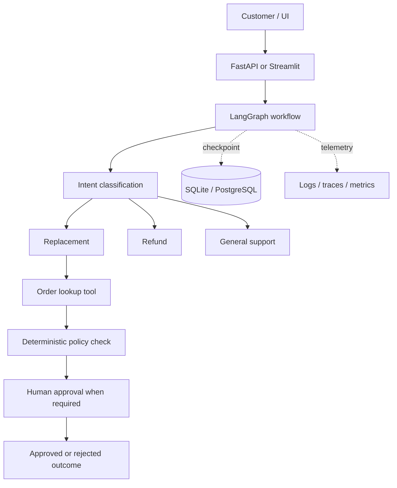
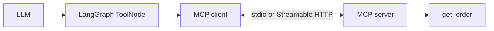

# LangGraph Lab — Customer Support Agent

Hands-on training in stateful AI agents, human approval, durable execution, production operations and Model Context Protocol (MCP). This README is also an interview review guide.

**Scope:** `lessons/` contains foundational exercises; `capstone/support_agent/` contains the customer support capstone and production experiments. The examples are independent learning programs, not one fully integrated production service. The inventory is based on the November 19 backup listing and recorded training sessions; the current repository source has not been independently executed or audited. Code snippets below illustrate patterns rather than reproduce every file verbatim.

## 1. Quick start

```bash
cd ~/langgraph-lab
poetry install
poetry run python capstone/support_agent/l01_basic_graph.py
```

Python 3.13 and Poetry were used in the lab. Use the existing lock file rather than upgrading packages before an interview. LLM exercises require `OPENAI_API_KEY`; PostgreSQL exercises require a running database and `LANGGRAPH_DATABASE_URL`. Keep credentials in environment variables or an ignored `.env` file and load them explicitly where needed. Never commit credentials or local databases. Individual scripts may require their own working directory or configuration.

## 2. Architecture at a glance



Conceptual architecture across the exercises; not every component is present in every script. The central design is to let the LLM interpret language while explicit workflow logic controls business policy and sensitive actions.

## 3. Foundational lessons

All paths in this table are relative to `lessons/`. Numbering follows existing filenames; gaps are intentional.

| Files | Review concept |
|---|---|
| `lesson01_state_graph.py` | State schema, nodes, edges, START/END, compile and invoke |
| `lesson02_conditional_edges.py`, `lesson02_refund_routing.py` | Conditional routing and deterministic decisions |
| `lesson03_llm_node.py` | Calling an LLM inside a node |
| `lesson04_tools.py`, `lesson04b_llm_tool.py` | Tool definitions, tool calls and results |
| `lesson05_checkpoint.py` | Checkpointing and thread identity |
| `lesson06_human_in_loop.py` | Pause and resume with human input |
| `lesson08_retry.py` | Transient failure recovery |
| `lesson09_multi_agent.py`, `lesson09c_multi_agent.py`, `lesson09d_multi_agent.py`, `lesson09e_multi_agent.py` | Multi-agent coordination variants |
| `lesson10_fastapi.py` | HTTP service interface |
| `lesson10b_postgres_checkpoint.py`, `lesson10b_postgres_recovery.py`, `test_postgres.py`, `test_postgres_saver.py` | Durable persistence and recovery |
| `lesson11_checkpoint_history.py`, `lesson11_get_checkpoint.py`, `lesson11_inspect_state.py`, `lesson11_replay_checkpoint.py` | Inspect, retrieve and replay checkpoints |
| `lesson12_error_types.py`, `lesson12_timeout.py` | Error classification and timeouts |
| `lesson13_approval.py`, `lesson13_resume.py` | Approval and resumption |
| `lesson14_subgraph_state.py` | Parent/child state boundaries |
| `lesson15_stream.py` | Streaming graph execution |
| `lesson16_graph_testing.py`, `lesson16_hitl_testing.py`, `lesson16_testing.py` | Workflow and approval tests |
| `lesson18_api.py`, `lesson18_capstone.py`, `lesson18_resume.py`, `customer_service_graph.py` | Integrated customer service examples |

### Core execution model

A `StateGraph` defines shared state and a workflow. Nodes return partial state updates; edges define transitions. A conditional edge selects the next node based on state. Reducers determine how multiple updates to the same field are merged. `MessagesState` uses the `add_messages` reducer, which merges messages by ID rather than simply replacing the entire history.

```python
from langgraph.graph import StateGraph, START, END
from typing import TypedDict

class State(TypedDict):
    status: str

def process(state: State):
    return {"status": "completed"}

builder = StateGraph(State)
builder.add_node("process", process)
builder.add_edge(START, "process")
builder.add_edge("process", END)
graph = builder.compile()
print(graph.invoke({"status": "pending"}))
```

**Interview distinction:** a node is an execution unit, state is the shared data contract, and an edge is a control-flow transition. A compiled graph provides the runtime. `ainvoke` supports asynchronous execution; it does not automatically make blocking code nonblocking.

## 4. Capstone — Support Agent lessons 1–9

Paths from here onward are relative to `capstone/support_agent/` unless specified.

| File | Purpose |
|---|---|
| `l01_basic_graph.py` | Basic customer support workflow and state |
| `l02_conditional_routing.py` | Replacement, refund and general support branches |
| `l03_llm_intent.py` | LLM-based intent understanding |
| `l04_tool_calling.py` | Order lookup and LLM/tool loop |
| `l05_policy_checks.py` | Business eligibility rules |
| `l06_human_approval.py` | Human review for sensitive decisions |
| `l07_error_handling.py` | Failure handling |
| `l08_persistent_memory.py` | SQLite-backed conversation/workflow persistence |
| `app.py` | Streamlit customer interface |

### Tool calling

`llm.bind_tools(tools)` exposes tool schemas to the model. The model returns an `AIMessage` with tool calls; it does not execute Python functions. `ToolNode` executes the requested tools and returns `ToolMessage` objects. Route back to the LLM to compose a grounded response. `tools_condition` routes to tools when calls exist and otherwise ends the loop.

The capstone used `get_order` to retrieve order information. A replacement workflow can check eligibility using trusted order data rather than letting the model invent policy decisions. The recorded example used order `ORD-1001` and a 30-day replacement window.

### Human-in-the-loop (HITL)

| Files | Topic |
|---|---|
| `hitl_lesson1.py`, `hitl_lesson2.py`, `hitl_graph.py` | Interrupt and approve/reject routing |
| `hitl_streamlit.py`, `hitl_streamlit_sqlite.py` | Human approval UI |
| `hitl_graph_sqlite.py`, `test_sqlite_recovery.py` | Durable pause/resume |
| `hitl_review_graph.py`, `hitl_review_streamlit.py` | Review workflow |
| `hitl_update_state.py` | State inspection/update patterns |

```python
from langgraph.types import interrupt, Command

# Inside a graph node:
# decision = interrupt({"question": "Approve replacement?"})

# Outside the node, resume the same checkpointed thread:
config = {"configurable": {"thread_id": "example-thread"}}
# graph.invoke(Command(resume={"approved": True}), config=config)
```

Use a checkpointer and the same thread ID to resume. The resume payload must match the node's expected schema. Interrupted nodes restart from their beginning when resumed, so code before an interrupt must be safe to repeat. Authenticate the reviewer and enforce approval permissions outside the LLM. Approval is not the same as executing the approved action; use idempotency keys for side effects.

### Checkpointing and memory

- Checkpoint: saved graph execution state, enabling inspection, resume and recovery.
- Thread ID: identifies a checkpointed execution/conversation lineage; not a user authentication credential.
- Short-term memory: conversation context associated with a thread.
- Long-term memory: selected information retained across threads, with separate storage and retrieval policies.
- `graph.get_state(config)` inspects state; `get_state_history` examines checkpoint history. Replay may rerun downstream nodes and side effects; it is not an automatic undo of external actions.
- Streamlit session state belongs to the UI session; LangGraph state belongs to the graph. The UI passes the thread ID to connect to the correct checkpointed workflow.

| Files | Long-term memory review |
|---|---|
| `long_term_memory_lesson1.py`, `long_term_memory_sqlite.py` | Persistent memory fundamentals |
| `long_term_memory_retrieve.py`, `long_term_memory_archive_retrieve.py` | Retrieve and archive messages |
| `long_term_memory_pruning.py` | Bound active context size |
| `long_term_memory_embeddings.py`, `long_term_memory_embedding_store.py` | Embeddings and storage |
| `long_term_memory_vector_search.py` | Semantic retrieval |
| `long_term_memory_customer_isolation.py` | Customer-specific isolation |

Do not send the entire history to the LLM indefinitely. Prune or summarize context while retaining necessary facts and tool-call/result pairs. Enforce tenant/customer isolation at retrieval and storage boundaries.

## 5. Production architecture

### FastAPI, persistence and recovery

| Files | Review |
|---|---|
| `api.py` | HTTP interface to the graph, replacement and state endpoints |
| `test_concurrency.py` | Concurrent replacement requests |
| `api_postgres.py`, `hitl_graph_postgres.py` | PostgreSQL-backed API and HITL |
| `test_postgres_checkpoint.py`, `inspect_postgres_history.py`, `resume_postgres_checkpoint.py` | Persistence, inspection and resume |
| `crash_recovery_demo.py` | Recover workflow after failure |

FastAPI handles transport and request validation; LangGraph handles workflow state and execution. PostgreSQL provides durable checkpoints shared across application processes. `PostgresSaver` requires database setup and a suitable connection lifecycle; use the async saver for async database operations where appropriate. A checkpoint does not guarantee exactly-once external execution. Protect concurrent updates to the same thread, and use idempotency and transaction/outbox patterns for external side effects.

Recorded lab result: five concurrent replacement requests returned HTTP 200 and pending/interrupted states. This was a functional concurrency exercise, not a production load benchmark.

### Reliability and load control

| File | Concept |
|---|---|
| `retry_demo.py` | Retry transient failures with bounded attempts/backoff |
| `timeout_demo.py` | Limit waiting and handle timeout failures |
| `queue_demo.py` | Buffer pending work |
| `backpressure_demo.py` | Bound queues and reject/defer overload |
| `semaphore_demo.py` | Limit simultaneous work |
| `rate_limit_demo.py` | Limit request frequency |
| `combined_limits_demo.py` | Combine concurrency and rate controls |

A semaphore limits in-flight work; a rate limiter limits starts over time; a bounded queue limits waiting work. They solve different problems. Retry temporary network failures, not invalid inputs or permanent authorization errors. Use exponential backoff with jitter, an overall deadline and idempotent operations. An async timeout does not necessarily cancel work already running in another system. In multi-worker deployments, process-local limits are not global limits. Graceful shutdown stops admission, drains or safely persists accepted work, then closes resources.

### Caching

| File | Review |
|---|---|
| `cache_demo.py` | Knowledge/data caching |
| `tool_cache_demo.py` | Tool result caching, e.g. order lookup |
| `llm_cache_demo.py` | Model response caching |

Choose keys that include relevant inputs, tenant identity and version; use TTL and invalidation appropriate to freshness. Do not cache authorization decisions or sensitive mutable data indiscriminately. LLM cache keys should include model, prompt, relevant context and configuration. A cache hit reduces latency/cost but can return stale information.

## 6. Observability and operations

| Files | Review |
|---|---|
| `logging_demo.py`, `structured_logging_demo.py` | Logs and structured event fields |
| `tracing_demo.py`, `async_tracing_demo.py`, `concurrent_tracing_demo.py` | Request and execution correlation |
| `automatic_tracing_demo.py`, `node_timing_demo.py`, `automatic_timing_demo.py` | Automatic instrumentation and node duration |
| `metrics_collection_demo.py` | Aggregate execution metrics |
| `opentelemetry_demo.py`, `otel_callback_demo.py` | Spans, parent/child relationships and callbacks |
| `prometheus_metrics_demo.py` | Counters and histograms |
| `prometheus_fastapi_demo.py` | HTTP execution and `/metrics` exposure |
| `grafana_webhook_receiver.py` | Alert notification receiver |

- Logs explain individual events; metrics quantify aggregate behavior; traces connect operations across a request.
- OpenTelemetry standardizes instrumentation and export; Prometheus scrapes and stores time series; Grafana visualizes and alerts. Jaeger/Tempo are possible trace backends, not confirmed deployed components of this lab.
- Counters increase (except resets); gauges can rise/fall; histograms represent distributions such as latency. Monitor throughput, errors, p95/p99 latency, queue depth, tool failures and model cost. Avoid high-cardinality metric labels such as thread IDs.
- Recorded tracing exercise: root LangGraph span with classify/retrieve/respond child spans. Recorded Prometheus exercise: five workflows, 15 node executions and zero errors.
- Lesson 8.11.12: verified a firing Grafana alert reached the webhook receiver. Lesson 8.12: `/health/live` and `/health/ready`, simulated dependency failure and restored readiness.
- Liveness asks whether the process should be restarted; readiness asks whether it can accept traffic. A database outage should generally affect readiness rather than trigger endless liveness restarts.

## 7. MCP — Model Context Protocol

| File | Purpose |
|---|---|
| `order_mcp_server.py` | FastMCP server exposing `get_order` |
| `mcp_langgraph_client.py` | Discover and invoke MCP tools |
| `mcp_langgraph_test.py` | Compiled graph with simulated tool call |
| `mcp_agent.py` | Actual LLM-driven tool selection |

The host is the application (LangGraph agent); the MCP client is the communication component inside it; the server exposes tools, resources or prompts. The client communicates directly with the server. MCP standardizes the interface, not the workflow or security policy.



### Server and discovery

```python
from mcp.server.fastmcp import FastMCP
mcp = FastMCP("Order Support Server")

@mcp.tool()
def get_order(order_id: str) -> dict:
    """Retrieve order information by order ID."""
    return {"order_id": order_id, "status": "delivered"}  # illustrative mock

if __name__ == "__main__":
    mcp.run(transport="stdio")
```

FastMCP derives input JSON Schema from the signature/type annotations/defaults and tool description from the docstring. `order_id: str` becomes a required string property. `tools/list` discovers metadata; `tools/call` invokes the tool. Server diagnostic logs normally go to stderr; stdout carries stdio protocol messages.

### Client and graph

```python
import sys
from pathlib import Path
from langchain_mcp_adapters.client import MultiServerMCPClient

# Inside async main(), in a script alongside the server:
server = Path(__file__).resolve().parent / "order_mcp_server.py"
client = MultiServerMCPClient({"orders": {
    "transport": "stdio", "command": sys.executable,
    "args": [str(server)],
}})
# tools = await client.get_tools()
# llm_with_tools = llm.bind_tools(tools)
# builder.add_node("tools", ToolNode(tools))
```

`sys.executable` uses the same Poetry environment. The lab resolved a dependency conflict by installing `mcp 1.30.0` and `langchain-mcp-adapters 0.3.2`; the latter required MCP >=1.24,<2.0. Direct `ToolNode.ainvoke` failed with missing runtime context in the installed LangGraph version; placing the node in a compiled `StateGraph` resolved it. The default adapter may create separate sessions for calls; do not assume session state persists across them.

```bash
poetry run python capstone/support_agent/mcp_langgraph_client.py
poetry run python capstone/support_agent/mcp_langgraph_test.py
poetry run python capstone/support_agent/mcp_agent.py
```

The real LLM selected `get_order` with `ORD-1001`; the server returned Laptop, delivered, three days since delivery. The model added an unverified calendar date and offered actions not implemented by tools. This is a useful grounding failure: validate claims and capabilities, not merely successful tool execution.

### Production security

Local stdio uses a subprocess; Streamable HTTP supports network deployment. Remote servers require appropriate transport security, authentication and authorization. The server must verify the caller's permission to access each order, validate inputs, limit tool privileges and log security events. The LLM is not a security boundary. Treat tool results as untrusted data; defend against prompt injection. Require approval and idempotency for sensitive writes. The HTTP deployment and security controls are design considerations, not completed implementations in this MCP exercise.

## 8. Testing and evaluation — interview extension

Distinguish deterministic workflow tests from probabilistic LLM evaluation. Unit-test nodes, policies and tool schemas; integration-test graph routing, persistence, interrupts and recovery; evaluate final answers for factual grounding, tool selection, argument correctness and task success. Use golden cases covering happy paths, missing orders, invalid inputs, denied access, timeouts, duplicate requests and adversarial content. Mock external tools for deterministic tests; run separate end-to-end tests with real dependencies. Track quality, latency and cost together. These are review recommendations, not a claim that all such tests exist in this repository.

## 9. Interview questions and concise answers

| Question | Answer |
|---|---|
| Why LangGraph instead of a simple LLM chain? | Explicit state, branching, cycles, durable execution and human approval. |
| What is a reducer? | A rule for merging updates to a state field, especially from parallel nodes. |
| Who executes an LLM tool call? | The application runtime, commonly ToolNode; the LLM emits the request. |
| How do you prevent incorrect routing? | Structured intent output, validation, deterministic routing and fallback handling. |
| How do you resume after human approval? | Persist state, use the same thread ID and invoke Command(resume=...) with validated input. |
| Checkpointer versus long-term store? | Checkpointer retains workflow state per thread; long-term store retains selected information across threads. |
| SQLite versus PostgreSQL? | SQLite is convenient locally; PostgreSQL supports shared durable persistence for multiple service instances. |
| Does checkpointing guarantee exactly-once execution? | No. External effects require idempotency and appropriate transaction design. |
| How do you scale an agent API? | Async I/O, bounded concurrency, queues, shared persistence, rate limits and load tests. |
| Rate limit versus semaphore? | Requests per time interval versus simultaneous work. |
| When should you retry? | Transient, safely repeatable failures within a bounded deadline. |
| How do you debug slow agents? | Trace per-node/tool/model latency, inspect p95/p99 and correlate with logs. |
| How do Prometheus and Grafana differ? | Prometheus collects/stores metrics; Grafana visualizes and alerts. |
| What is MCP? | A protocol for discovering and interacting with tools, resources and prompts. |
| MCP versus LangGraph? | MCP standardizes integration; LangGraph orchestrates stateful execution. |
| How do you secure MCP? | Authenticate, authorize each resource/action, validate inputs, use least privilege and audit. |
| How do you prevent hallucinations? | Ground in trusted data, validate output and enforce policy/capability boundaries; prompts alone are insufficient. |
| How do you test an agent? | Assert deterministic transitions and tool arguments; evaluate semantic quality separately. |

## 10. Suggested 90-minute interview review

| Time | Review |
|---|---|
| 15 min | StateGraph, reducers, conditional routing, tool loop |
| 15 min | HITL, checkpointing, memory and PostgreSQL recovery |
| 20 min | FastAPI, concurrency, backpressure, retries, caching |
| 15 min | Logs, metrics, traces, alerts and health checks |
| 15 min | MCP server/client/host, discovery and security |
| 10 min | Explain the capstone aloud and rehearse interview questions |

### 60-second project explanation

I built a customer support agent using LangGraph with explicit state and conditional routing for replacement, refund and general support. I integrated order lookup tools, deterministic business policy checks and human approval, then explored durable checkpointing with SQLite and PostgreSQL. I exposed workflows through Streamlit and FastAPI and implemented separate production exercises for concurrency, retries, caching, tracing, Prometheus metrics and Grafana alerts. Finally, I exposed an order lookup tool through MCP and connected it to an LLM-driven LangGraph workflow. The exercises demonstrated working integration and recovery patterns; production security, distributed load controls and comprehensive evaluation would require additional implementation and validation.

## Repository maintenance

```bash
git add README.md
git diff --cached --check
git commit -m "Document LangGraph lessons and support agent interview review"
git push origin main
git status
```

Repository: https://github.com/petkao/langgraph-lab
